# 멀티 에이전트 라우터 기업용 챗봇

사내 업무 질문을 **3단계(키워드 → 벡터 유사도 → LLM 판정)** 로 분류해 영업·프로젝트 수행·일반 에이전트로 보내고,
모호하면 되묻고(HITL), 두 영역에 걸치면 두 에이전트를 동시에 돌려 하나의 스트림으로 합치는 기업용 챗봇입니다.
수퍼바이저(라우터) · 도메인 에이전트 2개 · 웹 UI 를 한 레포에 담았고, API 키 없이 바로 띄워 볼 수 있습니다.

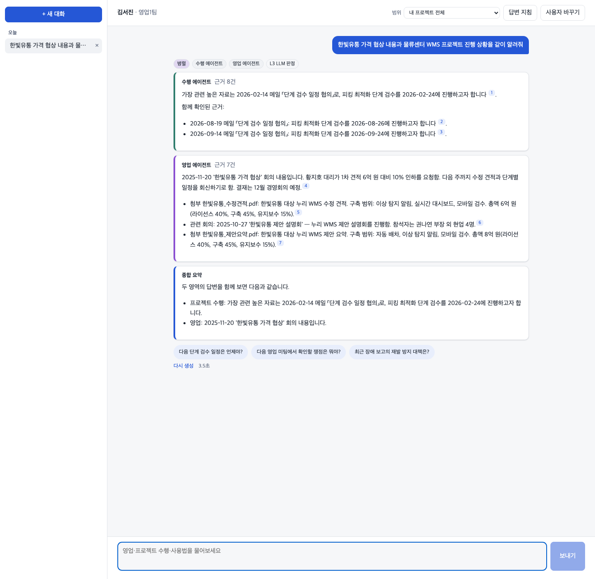

## 이 레포에 대해

- 실무에서 1인으로 설계·개발·운영한 사내 멀티 에이전트 AI 의 **아키텍처와 설계 판단을 가상 회사 "누리솔루션" 도메인으로
  처음부터 다시 구현한 스켈레톤**입니다. 기능·구조를 보여 주는 것이 목적이고, 답변 품질 수치는 목적이 아닙니다.
- 원 프로젝트의 코드·데이터·프롬프트·고객 정보는 들어 있지 않습니다. 회사·인물·자료는 모두 지어낸 것이고
  ([`data/generate.py`](data/generate.py)), 연락처는 `010-0000-xxxx` 와 예약 도메인(`.example`)만 씁니다.
- 구현에는 Claude Code 를 썼습니다. 설계 원칙·서비스별 명세([`docs/spec/`](docs/spec/))·검증 기준은 제가 정했고,
  결과물은 단위 테스트 213개 · 정적 검사 · 브라우저 e2e 로 확인했습니다.

## 실무 프로젝트에서 한 일

> 고객사 사내 업무 AI — 영업·프로젝트 수행 자료를 찾아 주는 멀티 에이전트 · 2026.05 – 2026.10 · **AI 백엔드 1인**
> 레거시 에이전트·인증·데이터를 분석해 새 Supervisor 아래 통합한 **브라운필드** 프로젝트
> 원 프로젝트 스택: Python · FastAPI · Azure OpenAI · Azure AI Search · Azure AI Foundry · Cosmos DB

아래 수치는 **원 프로젝트(실사용 로그 평가셋) 기준**이며, 이 레포에서 잰 값이 아닙니다.
오른쪽 열은 같은 설계를 이 레포에서 어디서 볼 수 있는지입니다.

| 성과 | 이 레포에서 보여 주는 곳 |
|---|---|
| **에이전트 통합** — 영업·수행으로 나뉜 기존 AI 에이전트 2종을 하나의 대화 창구로 통합. 설계부터 고객 시연·보안 진단·품질 평가 대응까지 6개월간 1인 수행 | 라우터 아래 두 도메인 에이전트 + 내장 일반 에이전트 ([`services/`](services/)) |
| **통합 인증** — 서비스마다 다른 레거시 인증을 분석해 공통 JWT(사번 기준)로 통합. 조직 단위 열람 권한을 토큰에 실어 DB 조회 없이 문서 필터 | 라우터만 발급하는 ES256 토큰, 권한 클레임(`project_ids` · `sales_units` · `can_read_contacts`) → 검색 필터 ([`auth.py`](packages/core/src/chatcore/auth.py), [`permissions.py`](services/sales-agent/src/sales_agent/permissions.py)) |
| **멀티 에이전트 구조** — 흩어진 대화 기록을 Supervisor 로 일원화(하위 에이전트 무상태). 하위 코드 수정 없이 응답 스트림 3종을 하나의 계약으로 정규화 | 저장은 라우터 한 곳, 하위에는 직전 대화를 잘라 전달([`agent_api.py`](packages/core/src/chatcore/agent_api.py)). 모든 서비스가 같은 이벤트 계약([`events.py`](packages/core/src/chatcore/events.py)) |
| **3 Layer 라우팅 (정확도 91.9%)** — 키워드 → 코사인 유사도 → LLM. 앞 단계는 확실할 때만 결정하고, LLM 확신도 대신 YES/NO + 근거로 판정해 비용 절감과 정확도 향상 | [`routing/`](services/router/src/router_service/routing/) — 레이어 격리, "정확히 한 도메인"일 때만 결정, 근거 없는 YES 는 NO |
| **HITL 선제안·설계·구현** — 선택 프로젝트·대화 맥락·이전 질문 기반 맞춤 재질문 3개 제안. 재질문 후 다시 HITL 로 가는 비율 46.7% → 3.3% | [`hitl.py`](services/router/src/router_service/runner/hitl.py) — 사용자 프로젝트를 자리표시자로 받아 권한과 대조(지어낼 수 없는 제안), 연속 되묻기 상한 |
| **로그 트레이스** — 소급할 수 없는 판단 근거·기준값·토큰·지연·버전을 처음부터 기록. ID 하나로 3개 서비스를 이어 원인 분석과 개선에 활용 | `RouteTrace`(레이어별 근거·top-3 점수·τ·판정 재료 해시·모델명·지연), 요청 ID·턴 ID 가 붙은 JSON 로그, task 별 토큰 사용량 |
| **믿을 수 있는 평가** — 실사용 로그 3,200문항 평가셋의 채점표 오류 발견·재라벨. 모델 교체 영향 분리, 회차 간 흔들림 측정으로 이상 기준을 규칙화 | [`eval/`](eval/) — 버전 있는 골드셋·채점표, dev/test 분리, 리포트에 모델·판정 재료 태그, `--repeat` 흔들림, `--ablate` 레이어 제거 비교 |

**주요 업무** — Supervisor · SSE 스트리밍 API, 레거시 에이전트 2종 인수·고도화(RAG 검색 · 프롬프트 인젝션 방어),
타 팀 시스템 연동(웹채널 · DB 미러 · 권한 뷰 · 검색 인덱스), 평가 파이프라인, Azure 운영 환경 구축,
Claude Code 맥락 관리(설계 원칙·결정 이력·미결 목록을 AI 가 매번 읽는 문서로 운영, 결정 약 400건을 인수인계까지 유지).
이 레포도 같은 방식으로 만들었습니다 — 명세([`docs/spec/`](docs/spec/))를 먼저 쓰고, 서비스별로 구현을 맡긴 뒤 테스트로 확인.

### 설계로 막은 문제들

멀티 에이전트 챗봇에서 흔히 생기는 문제와, 이 레포가 그것을 코드 구조로 막는 방법입니다.

| 흔히 생기는 문제 | 이 레포의 구조 |
|---|---|
| 기한을 넘긴 LLM 호출이 뒤에서 계속 돌며 토큰을 쓴다 | 턴 하나에 예산 하나(`Deadline`), 각 호출은 남은 예산만큼만 기다리고 넘으면 실제로 취소 |
| 같은 대화에 요청이 겹치면 질문·답이 엇갈리고, 재시작하면 맥락이 사라진다 | 턴 시작 때 `pending` 기록, 대화당 진행 턴 하나, 조건부 갱신, 기억은 저장소 한 벌 |
| 서버를 여러 대로 늘리면 프로세스 안에 둔 중지 상태가 공유되지 않는다 | 중지 요청을 저장소 플래그로 기록하고 실행기가 주기적으로 확인 |
| 요청별 값을 프로세스 공용 상태로 넘기면 동시 요청끼리 섞인다 | 직접 도구 호출 루프, 요청 컨텍스트는 명시적 인자로만 |
| 서비스 간 토큰을 대칭 비밀로 검증하면 검증하는 쪽도 발급할 수 있다 | 발급은 한 곳(비대칭 개인키), 하위 호출마다 에이전트 전용 `aud` 단기 토큰 |
| 대표 문장을 바꿔 쓴 문장으로 정한 임계값은 실사용 질문에서 통하지 않는다 | τ 는 임베더별 값, dev 에서 보정·test 로 확인, 다른 임베더면 L2 를 건너뜀 |
| 일반 질문·강제 지정·다시 생성마다 같은 파이프라인이 복사된다 | 실행기 하나에 plan 출처만 바꿈(cascade · forced · replay) |
| 연락처 원문이 대화 기록에 쌓인다 | 원문은 암호화 필드로만, 권한자만 받는 순간 복호화, 저장본은 다시 마스킹 |

## 아키텍처

### 1. 시스템 구성

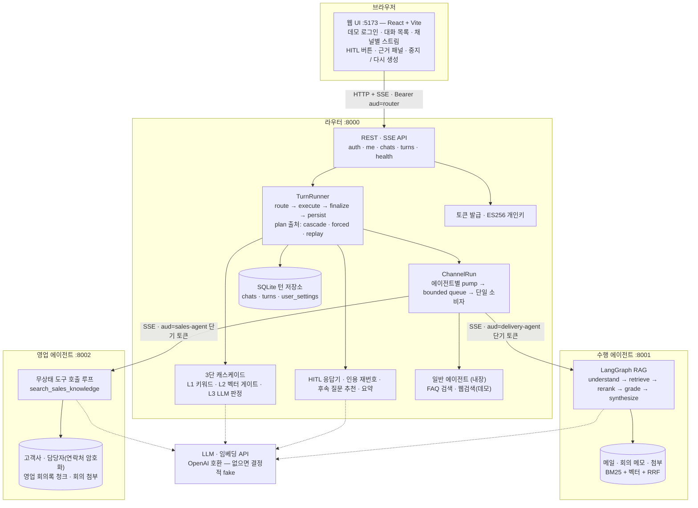

세 서비스는 공통 패키지 [`chatcore`](packages/core/src/chatcore/) 를 씁니다.

| 모듈 | 역할 |
|---|---|
| `llm` | `ChatModel` · `Embedder` 포트. OpenAI 호환 구현(OpenAI · Azure OpenAI v1 · Ollama)과 키 없이 도는 fake 구현. 공급자 오류는 타입 오류로 변환 |
| `events` · `sse` | 스트림 이벤트 계약(Pydantic). HTTP 경계에서만 SSE 로 직렬화, 하트비트 |
| `deadline` · `errors` | 요청 단위 시간 예산, 오류 코드 enum + 사용자용 메시지(내부 원인은 로그에만) |
| `auth` · `filters` | ES256 발급·검증과 권한 클레임, 타입 있는 검색 필터 AST(값이 필터 문법을 바꿀 수 없음) |
| `search` | BM25 + 벡터 + RRF 메모리 인덱스, 리랭커(어휘 / LLM) |
| `guard` · `privacy` | 출력 가드(canary · 길이), 사용자 지침 경계 래핑, 마스킹 · 필드 화이트리스트 · AES-GCM |
| `http` · `logs` | 순수 ASGI 미들웨어(요청 ID · 본문 크기), JSON 로그 |

### 2. 한 턴의 흐름 — 병렬 질문

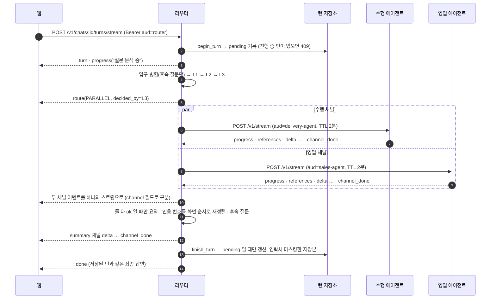

- **SINGLE** 은 채널 하나, **HITL** 은 `route → hitl → done(status=hitl)`, **BLOCKED** 는 `error(CONTENT_FILTERED) → done(status=blocked)` 입니다.
- **중지**: `POST …/turns/:turn_id/stop` → 저장소 `cancel_requested` → 실행기가 0.5초마다 확인 → 하위 스트림을 닫고 `channel_done(stopped)` · `done(stopped)`.
- **연결 끊김**: 제너레이터가 닫히면 그때까지의 답변을 `disconnected` 로 기록합니다(`asyncio.shield` 로 쓰기를 보호).
- 전체 이벤트 필드: [`docs/api-contract.md`](docs/api-contract.md) (Pydantic 모델에서 생성)

### 3. 3단 캐스케이드 라우팅

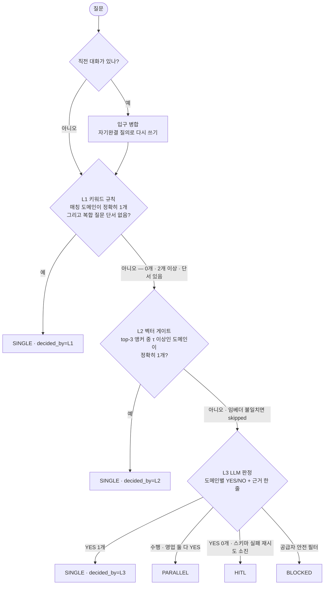

| 원칙 | 구현 |
|---|---|
| 레이어 격리 | 레이어는 `route(query) → LayerResult` 하나만 노출. 위 레이어의 점수·판단을 아래로 넘기지 않고, 어느 레이어를 빼도 동작(테스트로 확인) |
| 맥락은 입구에서 한 번 | 멀티턴 맥락은 입구에서 자기완결 질의로 병합하고, 모든 레이어가 같은 질의를 받는다 |
| 가중치 대신 이진 규칙 | 결정 조건은 레이어마다 "정확히 한 도메인". L1 의 exact / partial 은 키워드가 어느 목록에 있느냐로만 정한다 |
| LLM 확신도 불신 | 확신도는 보정되지 않은 자기 보고라 임계값으로 쓰지 않는다. YES/NO + 근거, 근거 없는 YES 는 NO |
| 병렬은 L3 만 | 키워드가 두 영역에 걸린 건 모호함의 신호. 두 갈래 질문인지는 문장을 읽는 L3 만 판단 |
| 판정 재료는 데이터 | 키워드 · 앵커 · τ · 판정 프롬프트는 버전 있는 YAML. 해시를 trace 에 남겨 결과 변화의 원인을 가른다 |

### 4. 수행 에이전트 — LangGraph RAG

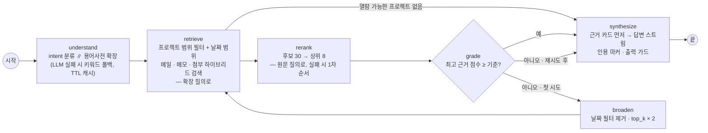

- 확장 질의(`CR` → `CR(변경요청, 변경 요청서)`)는 **검색 재현율에만** 쓰고, 관련도 판정은 사용자가 실제로 쓴 표현으로 합니다.
- 노드는 `get_stream_writer()` 로 이벤트를 흘리고, API 는 `astream(stream_mode="custom")` 을 그대로 SSE 로 내보냅니다.
- 본문의 전화번호 · 메일은 인덱스에 넣을 때 한 번 가립니다.

### 5. 영업 에이전트 — 무상태 도구 호출 루프

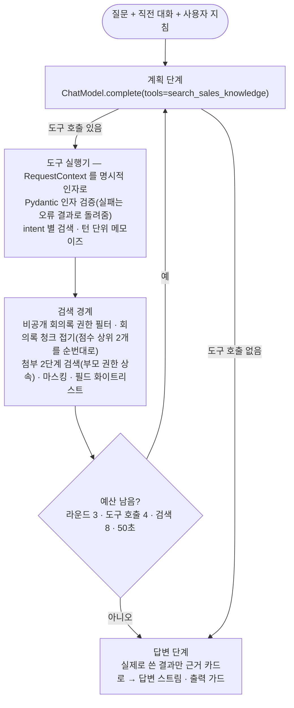

- 도구 스키마는 인자 모델(`SearchArgs.model_json_schema()`)에서 생성해 시그니처와 어긋나지 않습니다.
- intent 별로 결과를 따로 담아, 날짜 필터를 건 결과가 다른 intent 결과에 덮어써지지 않습니다.

### 6. 인증과 권한 · 개인정보

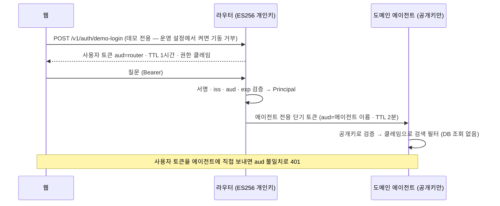

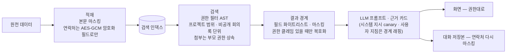

### 7. 턴 상태

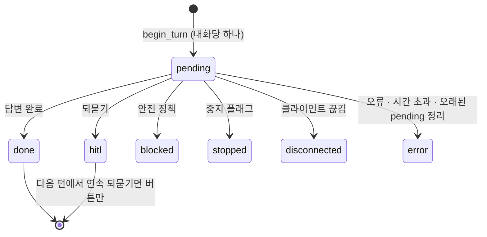

`finish_turn` 은 `WHERE status='pending'` 조건부 갱신이라 이미 끝난 턴을 덮지 않습니다.
대화 목록 API 와 멀티턴 맥락이 같은 테이블을 읽습니다(기억이 한 벌).

## 빠르게 실행해 보기

필요한 것: Python 3.13 + [uv](https://docs.astral.sh/uv/), Node.js 20 이상. API 키는 필요 없습니다(결정적으로 동작하는 fake LLM).

```bash
uv sync
uv run python scripts/dev.py      # 라우터 :8000 · 수행 :8001 · 영업 :8002 · 웹 :5173 을 한 번에
```

<http://localhost:5173> 에서 사용자를 고르고 질문해 보세요. **같은 질문도 사용자마다 볼 수 있는 자료가 다릅니다.**

| 사용자 | 권한 |
|---|---|
| 김서진 (영업1팀 과장) | 유통·물류 고객 비공개 회의록, 연락처 원문, 프로젝트 1개 |
| 이도윤 (사업수행1팀 PM) | 프로젝트 3개. 비공개 영업 자료 · 연락처 없음 |
| 박서연 (경영지원팀 사원) | 공개 영업 정보와 사용 안내만 |
| 최지훈 (영업2팀 팀장) | 제조·금융 고객 비공개 회의록, 연락처 원문, 프로젝트 3개 |

| 질문 | 경로 |
|---|---|
| `P-101 일정 지연 현황 알려줘` | L1 → 수행 에이전트 |
| `한빛유통 가격 협상 회의 내용 요약해줘` | L1 → 영업 (김서진은 비공개 회의록까지, 박서연은 공개 자료만) |
| `한빛유통 가격 협상 내용과 물류센터 WMS 프로젝트 진행 상황을 같이 알려줘` | L3 → 병렬 + 종합 요약 |
| `그거 어떻게 됐어?` | 되묻기 → 재질문 제안 · 영역 버튼 |
| `한빛유통 고객 담당자 연락처 알려줘` | 영업. 권한자만 원문, 다시 열면 저장본은 가려짐 |

| 되묻기 | 근거 패널 |
|---|---|
| 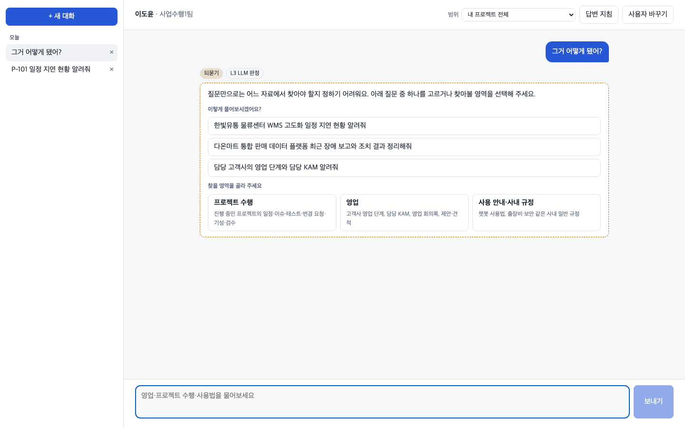 | 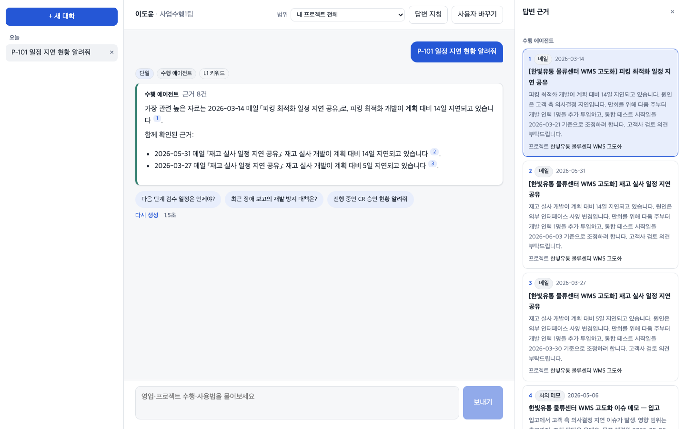 |

실제 모델은 OpenAI 호환 API(OpenAI · Azure OpenAI v1 · Ollama 등)로 붙입니다.

```bash
LLM_PROVIDER=openai LLM_API_KEY=... LLM_BASE_URL=... \
LLM_CHAT_MODEL=... LLM_EMBEDDING_MODEL=... uv run python scripts/dev.py
uv run python eval/run_eval.py calibrate-l2 --write   # 임베더가 바뀌면 τ 를 다시 정한다
```

## 평가 파이프라인

성능 수치가 목적은 아니고, **평가를 믿을 수 있게 만드는 장치**를 보여 줍니다([`eval/`](eval/)).

- 버전 있는 합성 골드셋(채점표 포함) · dev/test 분리 — 규칙과 임계값은 dev 에서만 고치고 test 로 확인
- 리포트마다 모델 · 임베더 · 판정 재료 해시를 남겨, 결과가 바뀐 원인(프롬프트인지 모델인지)을 가른다
- `--repeat` 로 같은 입력에 판정이 바뀌는 비율(잡음 바닥), `--ablate` 로 레이어를 하나씩 뺀 비교
- `calibrate-l2` 는 목표 정밀도(목표치)와 측정 정밀도(측정치)를 따로 적는다. 앵커 변형 문장으로 잡은 τ 가
  실사용형 문장에서 통하지 않는다는 점도 이 과정에서 드러난다([보정 리포트](eval/runs/calibrate-l2-2026-10-29/report.md))

```bash
uv run python eval/run_eval.py run --split test --ablate L1
```

## 테스트

```bash
uv run pytest packages services          # 213개 — 네트워크 · API 키 없이
uv run ruff check . && uv run pyright    # 정적 검사
cd web && npx playwright install chromium && npx playwright test   # e2e 5개 (전체 스택을 자동으로 띄움)
```

e2e 는 실제 브라우저에서 단일 · 병렬 · 되묻기 · 중지 · 연락처 권한(원문 / 저장본 마스킹 / `[비공개]`)을 확인합니다.

## 디렉토리

```text
packages/core/            공통 — 포트 · 이벤트 계약 · SSE · 인증 · 필터 · 검색 · 가드 · 개인정보 · 데드라인
services/router/          수퍼바이저 — routing/ · runner/ · agents/ · store.py · api/ · routing/*.yaml
services/delivery-agent/  수행 에이전트 — LangGraph RAG
services/sales-agent/     영업 에이전트 — 무상태 도구 호출 루프
web/                      React 채팅 UI + Playwright e2e
data/                     합성 데이터와 생성기
eval/                     골드셋 · 평가 실행기 · 리포트
docs/                     설계 결정 · 서비스 명세 · 이벤트 계약(생성) · 화면
scripts/                  전체 실행(dev.py) · 계약 내보내기
```

## 설계 결정

결정마다 "문제 → 결정 → 대가" 를 [`docs/decisions.md`](docs/decisions.md) 에 적었습니다.
서비스별 명세는 [`docs/spec/`](docs/spec/) 에 있습니다.

## 한계

- 스켈레톤입니다. 검색 인덱스는 메모리 구현, 저장소는 SQLite 하나, 웹 검색은 데모 결과입니다.
  각각 포트(`SearchIndex` · `TurnStore` · `WebSearch`)만 맞추면 운영용 구현으로 바꿀 수 있습니다.
- 여러 인스턴스로 띄우면 같은 DB 를 공유할 때만 중지 · 멀티턴이 맞습니다(운영이라면 Postgres 등).
- fake LLM 은 화면과 흐름을 확인하기 위한 것이라 답변 품질을 대표하지 않습니다.
